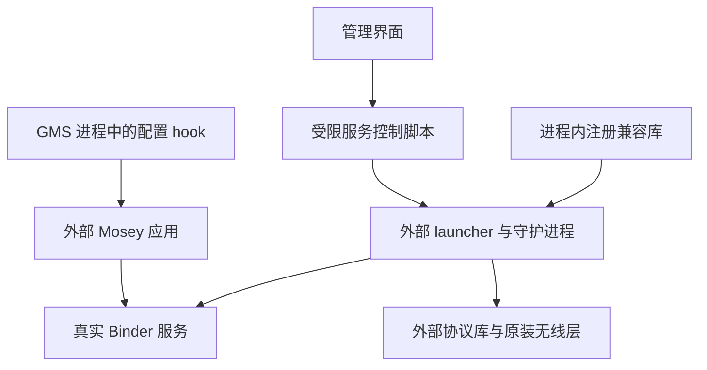

# 源码架构

项目将兼容逻辑分为客户端、原生注册、服务编排和主机工具。Google/厂商应用、守护进程、协议库及参考 launcher 由使用者另行准备，公开仓库不实现或分发它们。

图表示职责关系；每一层的成功需要分别验证。

## 客户端

[客户端](../client-compat/README.md) 包含普通 Activity 和 LSPosed 入口。Activity 提供状态、按需 root 和固定控制命令；hook 独立于 Activity 的 root 会话。

GMS 分支仅处理目标包的主用户主进程。解析器核对签名谱系、APK/DEX 内容、加载来源及配置语义，定位 Nearby `45704091` 的唯一 Boolean getter。有效自然 false 才被改为 true，异常和其他类型保留；详情见 [GMS 配置](gms-configuration.md)。

Mosey 分支只对准确服务名的声明限定查询进行兼容：非阻塞查询真实 Binder，复核存活与描述符后返回同一对象。应用 attach 后的有界后台任务可通过应用自身 Context 恢复唯一明确禁用的分享组件，不创建替身 Binder。

hook 状态快照位于目标应用自身 code cache，采用私有权限、大小限制和原子替换。管理端展示前复核启动、用户、进程和安装身份，缺少或过期记录视为未确认。AirDrop“已声明”只代表当前进程已经观察到目标 getter 最终 true。

## 原生注册与控制

[注册兼容库](../native/registration-compat/README.md) 在准确守护进程内拦截指定注册调用，校验身份、服务名、本地 Binder、描述符和平台符号来源，调用平台稳定性调整 API 后保留真实注册结果。它不更新系统的 VINTF 声明。

[注册脚本](../experiments/registration-compat/README.md) 负责载荷与身份校验、有界 readiness、锁、原生启动和结果核对。开机路径等待依赖就绪，交互控制采用独立的严格预检；两者共用操作锁。状态观察器分别报告 `Running`、`Stopped`、`Unregistered` 或 `Unknown`。

停止只针对有本轮所有权记录且身份复核成功的实例，由 [pidfd 辅助程序](../native/service-control/README.md) 发送 SIGTERM。缺少能力或身份不确定时拒绝操作。加载探针和主机假 Binder 用于验证实现边界，不能证明 Android 实际加载和业务行为。

## 外部集成

完整本地包还需要配套供体、参考 launcher、权限/init/VINTF 配置、限定策略和外部挂载机制。公开版保留来源路径与完整性检查所需的事实，不包含厂商配置正文。构建输入见 [构建说明](build.md)。

文件可见、系统特权身份、Binder 注册、应用查询、GMS 绑定、无线发现及完成传输分别属于不同证据层。源码架构和主机测试不能将这些层合并成一个可用性结论。
